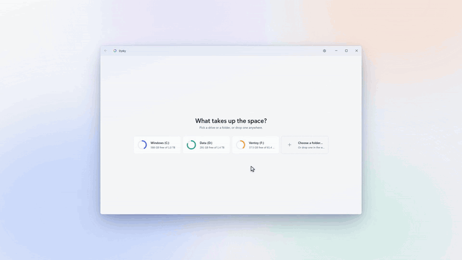
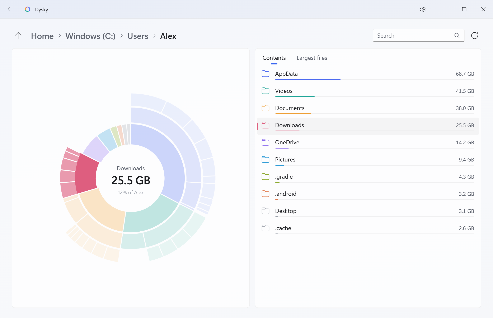
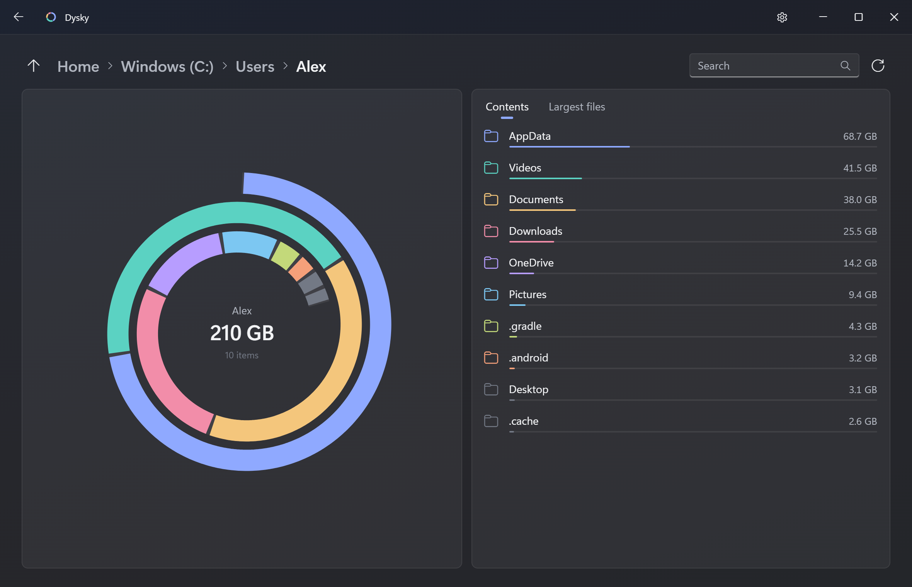
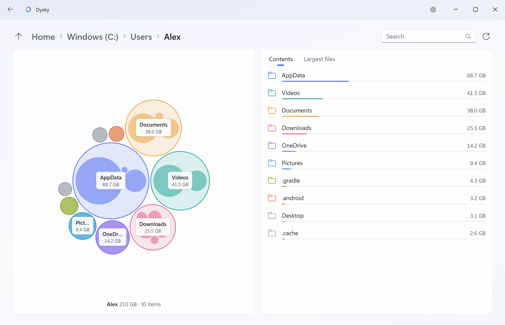
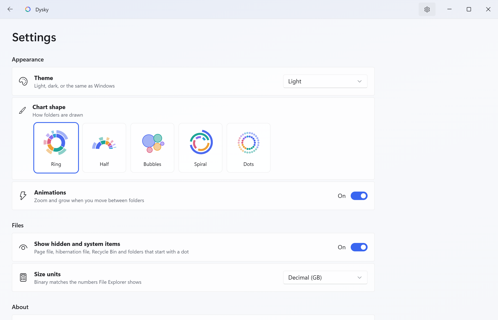

<div align="center">


<h1>Dysky</h1>

<p><b>See what takes up the space on your drives.</b></p>

<p>
  <a href="https://github.com/julekwinn/dysky/actions/workflows/ci.yml"></a>
  <a href="https://github.com/julekwinn/dysky/releases/latest"></a>
  <a href="LICENSE"></a>
  
  <a href="https://tauri.app"></a>
</p>

<p><a href="README.pl.md">Po polsku</a></p>



</div>

Dysky is a small disk space viewer for Windows 11, in the spirit of GNOME's Baobab, WinDirStat and WizTree. Pick a drive or a folder: Dysky scans it on every core and draws each folder as one interactive ring chart, with its files listed beside it. It only reads, so there is nothing to break.

## Features

- **Read-only by design.** Dysky never deletes, moves or changes your files. The right-click menu has exactly three items: Open, Copy path and Show in File Explorer.
- **Fast.** A parallel Rust scanner reads 1.4 million files on C: in about 20 seconds on a laptop. The ring fills in live as top-level folders finish.
- **One chart, every folder.** Click a slice to dive in with an animated zoom; hover a folder to light it up in both the chart and the list.
- **Five shapes.** Ring, Half, Bubbles, Spiral and Dots.
- **Search by name.** Just start typing; the chart lights up wherever the matches are.
- **Largest files** in the current folder, one tab away.
- **Honest sizes.** OneDrive online-only files count as 0 bytes, because they take no disk space; compressed and sparse files count what they actually take. Folders Dysky can't read are counted and reported, not silently dropped.
- **Feels like Windows 11.** The real Mica backdrop, WinUI-style dropdowns, toggle switches and menus, Fluent overlay scrollbars, light, dark or system theme, and a title bar that fades when another window has the focus. The window remembers its size and position.
- **Your units, your view.** Decimal (GB) or binary (GiB, what File Explorer counts); show or hide hidden and system items without scanning again.
- **Keyboard and screen reader friendly.** Arrow keys move through the list (the chart follows), type to search, Backspace to go up, F5 to scan again, Esc to cancel a scan, Ctrl+C to copy a path, Shift+F10 for the menu. High contrast themes are supported.
- **Tiny and private.** A 1.5 MB installer, a per-user install without admin rights, the WebView2 that is already in Windows, and no network access at all.

## Screenshots

| Light | Dark |
| --- | --- |
|  |  |
| **Bubbles** | **Settings** |
|  |  |

## Download

1. Open the [latest release](https://github.com/julekwinn/dysky/releases/latest).
2. Download `Dysky_X.Y.Z_x64-setup.exe` (about 1.5 MB) and run it. It installs for your user only, so it asks for no admin rights. Uninstall it from Settings → Apps.
3. The installer is not code-signed yet, so Windows SmartScreen may say "Windows protected your PC". Click **More info**, then **Run anyway**.

Dysky needs 64-bit Windows 10 (version 1809 or later) or Windows 11, and Microsoft Edge WebView2, which ships with Windows 11. If WebView2 is missing, as on some older Windows 10 installs, the installer downloads it from Microsoft.

## Build from source

You need [Rust](https://rustup.rs/) stable (MSVC), the Microsoft C++ Build Tools ("Desktop development with C++"), [Node.js](https://nodejs.org/) LTS and WebView2.

```powershell
git clone https://github.com/julekwinn/dysky.git
cd dysky
npm install      # the Tauri CLI
npm run dev      # run the app with live reload
npm test         # node --test and cargo test
npm run build    # installer: src-tauri\target\release\bundle\nsis\Dysky_<version>_x64-setup.exe
```

To work on the UI without building Rust, serve the project root and open `/src/index.html` in any browser. A preview backend with sample data stands in for the Rust side:

```powershell
npx serve .                    # then http://localhost:3000/src/index.html
python -m http.server 8000     # or this: http://localhost:8000/src/index.html
```

## Project structure

```text
dysky/
├── src/                      Frontend: plain HTML, CSS and ES modules, no build step
│   ├── index.html            The window: home, scan, browse and settings pages
│   ├── styles.css            Windows 11 look; light and dark in one set of light-dark() tokens
│   ├── app.js                Pages, list, search, menu, keyboard, settings
│   ├── chart.js              The five chart shapes and the motion between folders
│   ├── backend.js            The bridge to Rust, with the wire format documented
│   └── shapes.js             Pure helpers: sunburst layout, circle packing, size formatting
├── src-tauri/                Rust backend (Tauri 2)
│   ├── src/
│   │   ├── main.rs           App setup, plugins, crash report
│   │   ├── commands.rs       The IPC commands the window calls
│   │   ├── scan.rs           Parallel directory walk with rayon
│   │   ├── tree.rs           The flat depth-first arena and its queries
│   │   ├── drives.rs         Drives with their size and free space
│   │   └── win.rs            The few Win32 calls: size on disk, Mica, Show in File Explorer
│   ├── capabilities/         What the window is allowed to call
│   └── tauri.conf.json       Window, CSP and installer settings
├── dev/preview-backend.js    Sample-data stand-in for Rust in a plain browser
├── tests/                    node --test suites: chart geometry and the preview backend
├── docs/                     Architecture notes and README media
└── .github/                  CI, release workflow, issue templates
```

## How it works

1. **Scan.** `scan.rs` walks the folder tree with [rayon](https://github.com/rayon-rs/rayon), one task per folder, so every core keeps the disk busy. Sizes come from the directory listing itself (no file is opened). Symbolic links and junctions are skipped, so nothing is counted twice and nothing loops.
2. **Flat arena.** The finished tree is flattened depth-first into one `Vec` of small entries (name, size, size without hidden items, parent, end, flags). A folder's contents are the contiguous range `id+1 .. end`, so any subtree is one slice of memory, with no pointers to chase.
3. **Small views over IPC.** The window never receives the whole tree. For each folder it asks for a *view*: up to 500 children for the list, and three levels deep for the chart, where deeper levels only keep pieces at least 0.15% of the folder, big enough to draw. Everything else is summed up as "N more items". A click costs a few kilobytes of JSON even on a drive of millions of files.
4. **Geometry in JS.** `shapes.js` turns a view into ring sectors or packed circles with pure functions; `chart.js` draws them as SVG and animates the zoom between folders.

It is fast because the walk keeps every core busy, each entry costs a few dozen bytes, every query is a linear pass over contiguous memory, the hidden-item sizes are computed once during the scan (so toggling them needs no rescan), and the UI only gets what it draws. The details are in [docs/ARCHITECTURE.md](docs/ARCHITECTURE.md).

## FAQ

**Why do the numbers differ from File Explorer?**
A few honest reasons:
- *Units.* File Explorer counts in binary units but labels them "GB". Pick Settings → Size units → Binary (GiB) to match it.
- *Hard links.* A file with several names (common in `C:\Windows\WinSxS`) is counted once per name, so C: can show a bit more than the "Used space" Windows reports.
- *Size on disk.* Dysky adds up what files take on the disk, while Explorer's "Size" column shows their full length; see the OneDrive answer below.
- *What can't be listed.* Folders Dysky isn't allowed to read count as empty, and "Used space" also includes NTFS metadata and System Restore snapshots, which no folder listing shows.

**Are hard links counted twice?**
Yes, once per link, for now. Counting each file once by its file ID is on the roadmap.

**What about OneDrive files?**
Online-only files are placeholders that take no disk space, so they count as 0 bytes. Files kept on the device count at their full size. Dysky reads only the directory listing, so it never makes OneDrive download anything.

**Does it need admin rights?**
No. It installs and runs as your user. Without admin rights a few system folders (System Volume Information, other users' profiles, parts of `C:\Windows`) can't be read; they are skipped, and the scan tells you how many there were.

**Does it use the network?**
No. No telemetry, no update checks, no accounts. The window's Content Security Policy only allows connections to Tauri's `ipc:` channel, so even the UI can't reach the internet.

**Can it delete files?**
No, and that is by design. No code path in Dysky writes, moves or deletes your files. Find what you want to remove, use Show in File Explorer, and delete it there, where the Recycle Bin has your back.

## Roadmap

- Count hard links once, by volume and file ID
- A fast path that reads the NTFS MFT directly when Dysky runs elevated, like WizTree
- Export a folder or the largest files to CSV or JSON
- A code-signed installer, so SmartScreen stops warning
- An arm64 build
- The Snap Layouts flyout on the maximize button, and the system menu on a right-click of the title bar
- winget and Microsoft Store packages

Ideas and votes are welcome in [issues](https://github.com/julekwinn/dysky/issues).

## Contributing

Bug reports, ideas and pull requests are welcome. [CONTRIBUTING.md](CONTRIBUTING.md) covers the setup, tests, code style and release process; [docs/ARCHITECTURE.md](docs/ARCHITECTURE.md) explains the internals. Security issues go through [SECURITY.md](SECURITY.md).

## Similar projects

- [WinDirStat](https://windirstat.net/): the classic Windows treemap
- [WizTree](https://diskanalyzer.com/): very fast on Windows, reads the MFT
- [SpaceSniffer](https://www.uderzo.it/main_products/space_sniffer/): zoomable treemap for Windows
- [Baobab](https://apps.gnome.org/Baobab/) (Disk Usage Analyzer): GNOME's ring chart, Dysky's main inspiration
- [Filelight](https://apps.kde.org/filelight/): KDE's concentric rings
- [dust](https://github.com/bootandy/dust): `du` with bars, in Rust
- [dua-cli](https://github.com/Byron/dua-cli): interactive terminal disk usage, in Rust
- [gdu](https://github.com/dundee/gdu): fast terminal disk usage, in Go

## License

[MIT](LICENSE) © 2026 Youlius

<p align="center"><sub>Made by <a href="https://youlius.com">Youlius</a></sub></p>
