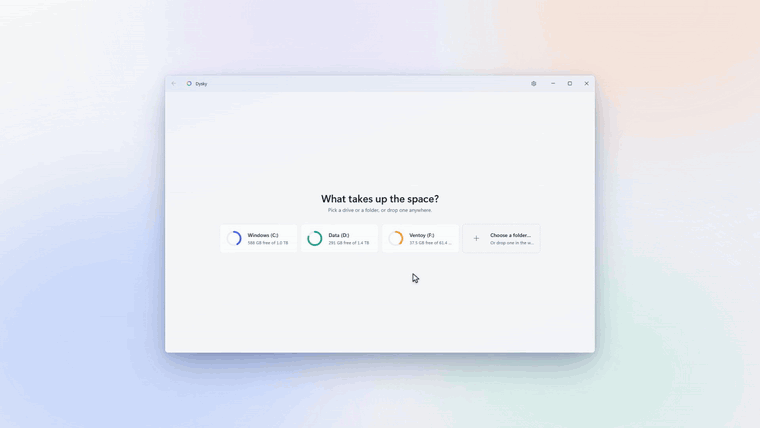
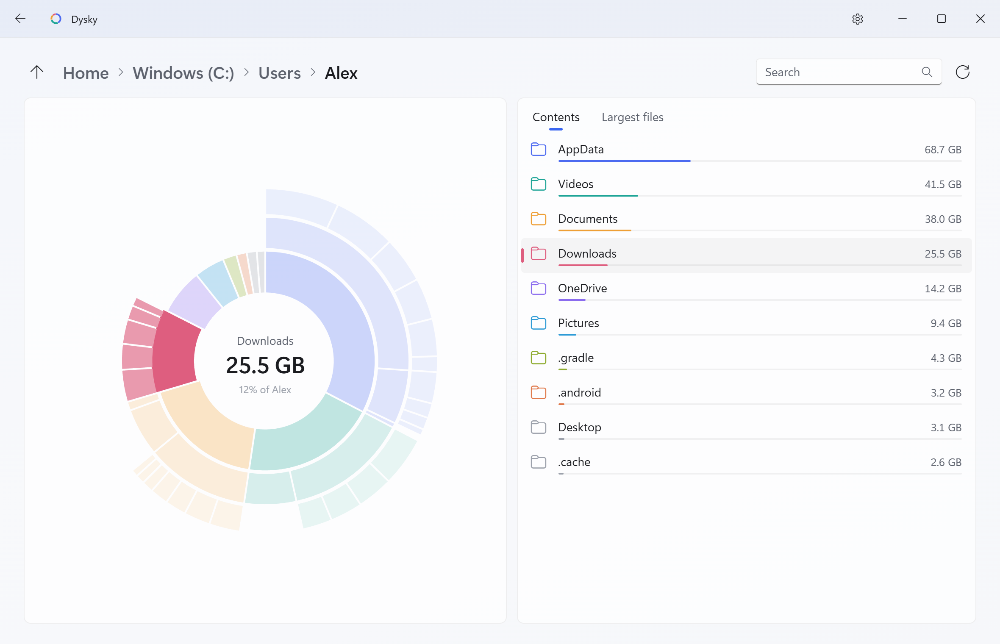
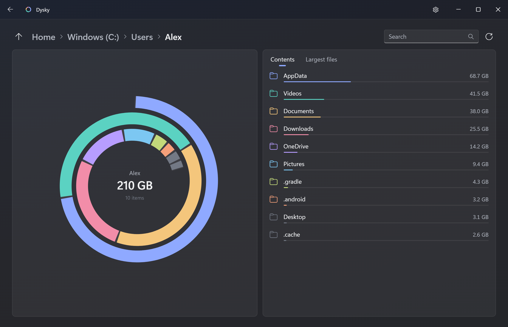
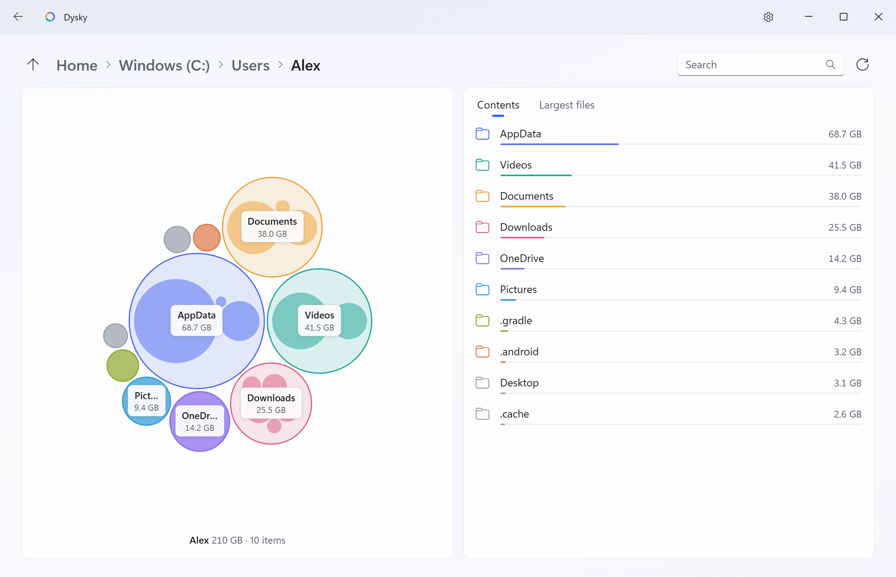
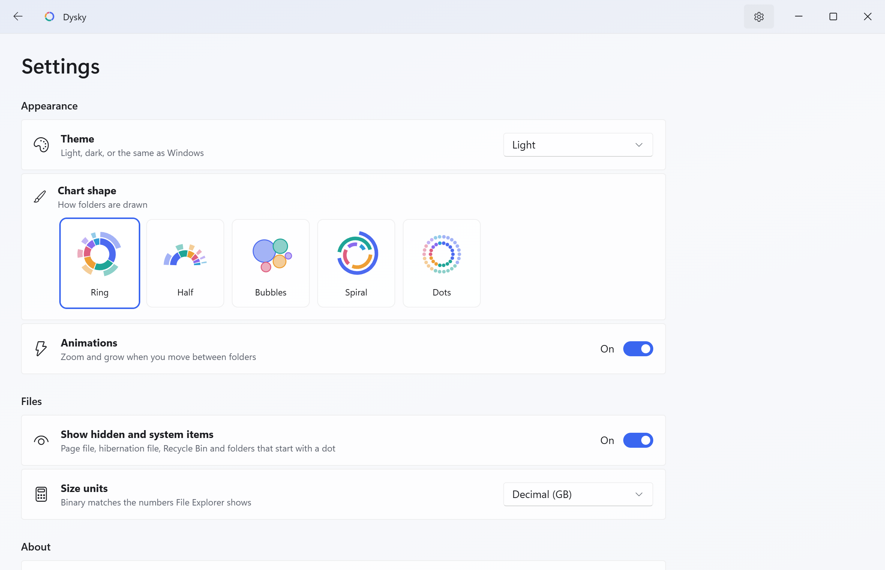

<div align="center">


<h1>Dysky</h1>

<p><b>Zobacz, co zajmuje miejsce na Twoich dyskach.</b></p>

<p>
  <a href="https://github.com/julekwinn/dysky/actions/workflows/ci.yml"></a>
  <a href="https://github.com/julekwinn/dysky/releases/latest"></a>
  <a href="LICENSE"></a>
  
  <a href="https://tauri.app"></a>
</p>

<p><a href="README.md">In English</a></p>



</div>

Dysky to mały program na Windows 11, który pokazuje, co zajmuje miejsce na dysku, w duchu Baobaba z GNOME, WinDirStata i WizTree. Wybierasz dysk albo folder, Dysky skanuje go na wszystkich rdzeniach i rysuje każdy folder jako jeden interaktywny wykres pierścieniowy, a obok listę plików. Program tylko czyta, więc niczego nie zepsuje.

## Co umie

- **Tylko czyta.** Dysky niczego nie usuwa, nie przenosi ani nie zmienia. Menu pod prawym przyciskiem ma trzy pozycje: Open, Copy path i Show in File Explorer.
- **Jest szybki.** Równoległy skaner w Rust czyta 1,6 mln plików na C: w około 30 sekund na laptopie. Pierścień zapełnia się na żywo, w miarę jak kończą się kolejne foldery.
- **Jeden wykres na każdy folder.** Klikasz kawałek i wchodzisz do środka z animacją; najechanie podświetla folder na wykresie i na liście naraz.
- **Pięć form wykresu:** Ring, Half, Bubbles, Spiral i Dots.
- **Szukanie po nazwie.** Wystarczy zacząć pisać, a wykres podświetla miejsca z wynikami.
- **Największe pliki** w bieżącym folderze w osobnej zakładce.
- **Uczciwe rozmiary.** Pliki OneDrive dostępne tylko online liczą się jako 0 bajtów, bo nie zajmują dysku; pliki skompresowane i rozrzedzone liczą się tyle, ile naprawdę zajmują. Foldery, których nie da się odczytać, są policzone i zgłoszone po skanie.
- **Wygląda jak Windows 11.** Prawdziwe tło Mica, listy rozwijane, przełączniki i menu jak w WinUI, przewijanie Fluent, motyw jasny, ciemny albo jak w systemie, pasek tytułu blednie, gdy aktywne jest inne okno. Okno pamięta swój rozmiar i położenie.
- **Jednostki i widok po Twojemu.** GB albo GiB (jak w Eksploratorze plików); ukryte i systemowe pliki włączasz i wyłączasz bez ponownego skanu.
- **Klawiatura.** Pisanie szuka, Backspace cofa, F5 skanuje od nowa, Ctrl+C kopiuje ścieżkę.
- **Mały i prywatny.** Instalator 1,4 MB, instalacja tylko dla Twojego konta bez uprawnień administratora, WebView2, który już jest w Windows, i zero połączeń z siecią.

## Zrzuty ekranu

| Jasny | Ciemny |
| --- | --- |
|  |  |
| **Bąbelki** | **Ustawienia** |
|  |  |

## Pobieranie

1. Otwórz [najnowsze wydanie](https://github.com/julekwinn/dysky/releases/latest).
2. Pobierz `Dysky_X.Y.Z_x64-setup.exe` (ok. 1,4 MB) i uruchom. Instaluje się tylko dla Twojego konta, więc nie pyta o uprawnienia administratora. Odinstalujesz go w Ustawieniach → Aplikacje.
3. Instalator nie jest jeszcze podpisany, więc Windows SmartScreen może pokazać „System Windows ochronił ten komputer”. Kliknij **Więcej informacji**, potem **Uruchom mimo to**.

Potrzebny jest 64-bitowy Windows 10 (od wersji 1809) albo Windows 11 i Microsoft Edge WebView2, który jest w Windows 11. Jeśli go brakuje, jak na niektórych starszych Windows 10, instalator pobierze go od Microsoftu.

## Budowanie ze źródeł

Potrzebne są [Rust](https://rustup.rs/) stable (MSVC), Microsoft C++ Build Tools („Desktop development with C++”), [Node.js](https://nodejs.org/) LTS i WebView2.

```powershell
git clone https://github.com/julekwinn/dysky.git
cd dysky
npm install      # Tauri CLI
npm run dev      # aplikacja z podglądem na żywo
npm test         # node --test i cargo test
npm run build    # instalator: src-tauri\target\release\bundle\nsis\Dysky_<wersja>_x64-setup.exe
```

Okno można też otworzyć w zwykłej przeglądarce, bez budowania Rust: wystarczy serwer dla głównego folderu projektu i adres `/src/index.html`. Zamiast Rust odpowiada wtedy podgląd na przykładowych danych:

```powershell
npx serve .                    # potem http://localhost:3000/src/index.html
python -m http.server 8000     # albo tak: http://localhost:8000/src/index.html
```

## Co gdzie jest

```text
dysky/
├── src/                      okno: czysty HTML, CSS i moduły ES, bez kroku budowania
│   ├── index.html            strony: start, skan, przeglądanie, ustawienia
│   ├── styles.css            wygląd Windows 11, jasny i ciemny motyw
│   ├── app.js                strony, lista, szukanie, menu, klawiatura, ustawienia
│   ├── chart.js              pięć form wykresu i animacje między folderami
│   ├── backend.js            most do Rust z opisem formatu danych
│   └── shapes.js             czyste funkcje: układ pierścieni, upakowanie bąbelków, rozmiary
├── src-tauri/                strona Rust (Tauri 2)
│   ├── src/
│   │   ├── main.rs           start aplikacji, wtyczki, raport o awarii
│   │   ├── commands.rs       polecenia, o które pyta okno
│   │   ├── scan.rs           równoległy skan folderów (rayon)
│   │   ├── tree.rs           płaska lista w kolejności w głąb i pytania o nią
│   │   ├── drives.rs         dyski z rozmiarem i wolnym miejscem
│   │   └── win.rs            kilka wywołań Win32: rozmiar na dysku, Show in File Explorer
│   ├── capabilities/         co okno może wywołać
│   └── tauri.conf.json       okno, CSP i instalator
├── dev/preview-backend.js    zastępstwo Rust na przykładowych danych, do przeglądarki
├── tests/                    testy node --test dla shapes.js
├── docs/                     opis budowy i media do README
└── .github/                  CI, wydania, szablony zgłoszeń
```

## Jak to działa

1. **Skan.** `scan.rs` przechodzi po folderach z [rayon](https://github.com/rayon-rs/rayon), jedno zadanie na folder, więc wszystkie rdzenie pracują naraz. Rozmiary biorą się z samej listy folderu, bez otwierania plików. Linki symboliczne i junctions są pomijane, więc nic nie liczy się dwa razy i nic się nie zapętla.
2. **Płaska lista.** Gotowe drzewo trafia do jednego `Vec` w kolejności w głąb (nazwa, rozmiar, rozmiar bez ukrytych, rodzic, koniec, flagi). Zawartość folderu to ciągły zakres `id+1 .. end`, więc każde poddrzewo to jeden kawałek pamięci.
3. **Małe widoki przez IPC.** Okno nigdy nie dostaje całego drzewa, tylko widok folderu: do 500 elementów listy i trzy poziomy wykresu, gdzie głębsze poziomy mają tylko kawałki od 0,15% folderu, czyli takie, które da się narysować. Reszta jest zsumowana jako „N more items”. Kliknięcie to kilka kilobajtów JSON, nawet przy milionach plików.
4. **Geometria w JS.** `shapes.js` zamienia widok na wycinki pierścieni albo upakowane koła czystymi funkcjami, a `chart.js` rysuje je w SVG i animuje przejścia.

Szczegóły są w [docs/ARCHITECTURE.md](docs/ARCHITECTURE.md) (po angielsku).

## Pytania

**Dlaczego liczby różnią się od Eksploratora plików?**
- *Jednostki.* Eksplorator liczy w jednostkach binarnych, ale pisze „GB”. Ustaw Settings → Size units → Binary (GiB), żeby było tak samo.
- *Twarde dowiązania.* Plik z kilkoma nazwami (często w `C:\Windows\WinSxS`) liczy się raz na każdą nazwę, więc C: może pokazać trochę więcej niż „Zajęte miejsce” w Windows.
- *Rozmiar na dysku.* Dysky sumuje to, co pliki zajmują na dysku, a kolumna „Rozmiar” w Eksploratorze pokazuje pełną długość pliku.
- *Czego nie widać.* Foldery bez dostępu liczą się jako puste, a „Zajęte miejsce” obejmuje też metadane NTFS i punkty przywracania systemu, których nie widać w żadnym folderze.

**Czy twarde dowiązania liczą się podwójnie?**
Tak, na razie raz na każdą nazwę. Liczenie każdego pliku raz, po jego identyfikatorze, jest w planach.

**A pliki OneDrive?**
Pliki tylko online to zaślepki, które nie zajmują dysku, więc liczą się jako 0 bajtów. Pliki trzymane na urządzeniu liczą się w całości. Dysky czyta tylko listę folderu, więc OneDrive niczego przez niego nie pobiera.

**Czy potrzebne są uprawnienia administratora?**
Nie. Bez nich kilku folderów systemowych nie da się odczytać (System Volume Information, profile innych użytkowników, części `C:\Windows`); są pomijane, a po skanie widać, ile ich było.

**Czy Dysky łączy się z siecią?**
Nie. Bez telemetrii, sprawdzania aktualizacji i kont. Polityka CSP okna pozwala tylko na połączenia z kanałem `ipc:` Tauri, więc nawet okno nie dosięgnie internetu.

**Czy można nim usuwać pliki?**
Nie, celowo. Żaden kod w Dysky nie zapisuje, nie przenosi ani nie usuwa Twoich plików. Znajdź to, co chcesz usunąć, wybierz Show in File Explorer i usuń tam, gdzie chroni Cię Kosz.

## Plany

- Liczenie twardych dowiązań raz, po identyfikatorze pliku
- Szybki tryb przez odczyt tablicy MFT, gdy Dysky działa jako administrator (jak WizTree)
- Eksport folderu albo największych plików do CSV lub JSON
- Podpisany instalator, żeby SmartScreen przestał ostrzegać
- Wersja na arm64
- Paczki w winget i Microsoft Store

## Współpraca

Zgłoszenia błędów, pomysły i pull requesty są mile widziane. Instrukcje są w [CONTRIBUTING.md](CONTRIBUTING.md), a sprawy bezpieczeństwa w [SECURITY.md](SECURITY.md) (po angielsku).

## Podobne programy

[WinDirStat](https://windirstat.net/), [WizTree](https://diskanalyzer.com/), [SpaceSniffer](https://www.uderzo.it/main_products/space_sniffer/), [Baobab](https://apps.gnome.org/Baobab/) (główna inspiracja), [Filelight](https://apps.kde.org/filelight/), a w terminalu [dust](https://github.com/bootandy/dust), [dua-cli](https://github.com/Byron/dua-cli) i [gdu](https://github.com/dundee/gdu).

## Licencja

[MIT](LICENSE) © 2026 Youlius

<p align="center"><sub>Zrobione przez <a href="https://youlius.com">Youlius</a></sub></p>
